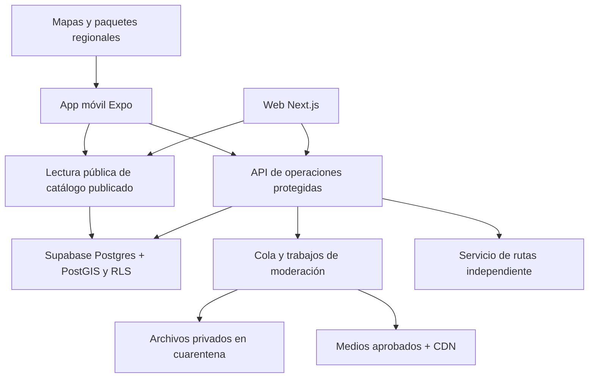

# Propuesta técnica — descubrimiento regional de Chile

Estado: propuesta para revisión, 24-10-2026. Nombre elegido para continuar: Territorio Vivo. Solo Fase 0.

Dirección visual confirmada: mezcla de las propuestas A/B con preferencia oscura; claro y oscuro serán temas de la misma estructura. Véase [la decisión visual](diseno/PROPUESTAS.md). La V02 quedó aprobada como base visual. El usuario indicó avanzar al esqueleto y generar APK en GitHub Actions; iOS debe contemplarse desde el inicio. Estado actual en [ESQUELETO-APK.md](ESQUELETO-APK.md). Las propuestas antiguas de este documento se leen junto a esa decisión posterior.

La preparación de datos públicos se registra en [FUENTES-DATOS.md](FUENTES-DATOS.md); las consultas iniciales están bloqueadas por la política de red y no se importaron registros.

El detalle para revisar cada pantalla y preparar entregas Android está en [Pantallas y primeras APK](diseno/PANTALLAS.md).

Este documento traduce la visión de [PLAN.md](PLAN.md) en una arquitectura y entregas. No aprueba tecnologías, servicios contratados ni funciones posteriores. El plan original se conserva como registro; sus secciones 10 y 11 contienen la evolución de la idea.

## Resultado que buscamos primero

Una maqueta Android instalable mediante APK generada en GitHub Actions, con una base React Native compartida para iOS y datos de ejemplo identificados, para comprobar la experiencia de recorrer regiones, explorar tarjetas y preparar visualmente un viaje. Sin cuentas reales, pagos, base productiva, seguimiento de ubicación ni cálculo real de rutas. Antes de construirla se presenta y aprueba el esqueleto. Las propuestas visuales actuales son imágenes, no una APK.

Dos puertas de revisión: primero dirección visual y alcance; después estructura técnica y esqueleto. No se construyen funciones de Fase 1 en esta entrega. La arquitectura completa describe el destino futuro, no todo lo que se instalará ahora.

## Arquitectura recomendada

Monorepo con TypeScript y pnpm, versiones exactas y lockfile. Empezar con workspaces y comandos explícitos; no hace falta añadir un orquestador de builds hasta que el tiempo de CI lo justifique.

```text
apps/
  mobile/              Expo + React Native + Expo Router
  web/                 Next.js: presentación pública y futuros paneles
packages/
  core/                Tipos, contratos, validación y lógica pura
  i18n/                Mensajes por idioma: es, después en y pt
  design-tokens/       Colores, espacios, tipografía y movimiento
supabase/
  migrations/          Esquema versionado y RLS al incorporar datos reales
  tests/               Pruebas de permisos y aislamiento
  config.toml          Configuración local al incorporar Supabase
.github/workflows/     Validación de cambios
scripts/               Validación y herramientas del repositorio
AGENTS.md
CLAUDE.md
docs/
```

Es una propuesta, estos directorios no se han creado. `packages/core` no importa React, Expo, Next.js ni SDKs de mapas. Se comparten reglas y contratos; no se obliga a compartir componentes visuales entre web y móvil. La app web puede empezar como página mínima sin paneles funcionales. Los mensajes de interfaz se resuelven por claves; los componentes no contienen textos de usuario fijos. Contenido aportado por usuarios y traducciones de interfaz son problemas distintos: no prometer traducción automática de las fichas.

Expo permite preparar una app Android e iOS desde una base común. Para probar mapas nativos y módulos que no estén en Expo Go se necesitará un development build. Antes de fijar versiones se verificará compatibilidad entre Expo, React Native, Node, SDK de mapas y herramientas Android; no se heredan las versiones de los otros proyectos.

## Componentes y responsabilidades



La lectura simple puede utilizar Supabase con una clave pública y RLS; las operaciones que exigen secretos, límites o validación privilegiada pasan por una API. Una clave pública nunca sustituye las políticas de autorización. La API puede empezar en funciones de Supabase; el ruteo y los trabajos largos requieren procesos separados y no una función de corta duración. No duplicar reglas de negocio entre Next.js y funciones: contratos y validaciones puras en core.

## Maqueta, antes de servicios reales

- Repositorio de datos local intercambiable por una API futura. Los ejemplos no contienen contactos reales, estrellas inventadas ni negocios presentados como verificados.
- Portadas regionales ilustradas, con recursos locales pequeños. Lista de regiones con orden norte-sur explícito; IDs estables independientes de nombres traducidos.
- Estado separado: región física detectada, región consultada y lugar elegido para el viaje. Cambiar de región nunca solicita de nuevo la ubicación.
- Máquina de estados para navegación: región en reposo, gesto en curso, transición, región destino. Una selección nueva cancela la anterior; sin animaciones acumuladas.
- Selector muestra las 16 regiones. Solo se compromete el destino al finalizar el salto; las regiones de paso se dibujan desde recursos locales y no disparan peticiones.
- Hipótesis de animación: 100–200 ms por región, con límite total inicial de 1,5 s que se evaluará. Preferencia de reducir movimiento: cambio directo o fundido breve. Sin bucle entre extremos.
- Un gesto vertical cambia de región en la portada. Las listas extensas viven en Explorar, Eventos y detalles, donde el desplazamiento vertical recorre contenido. Los controles accesibles Norte/Sur complementan al gesto, no lo reemplazan.
- Cambiar el fondo regional no cambia filtros. Cada motivo identifica su lugar y que es una ilustración de referencia.
- Mi viaje es una representación de ejemplo, sin afirmar kilómetros, tiempos ni desvíos calculados.

## Datos futuros y publicación

Entidades propuestas, todavía sin migraciones: regiones, provincias, comunas; oferentes y membresías; fichas; puntos visitables y áreas de servicio; eventos; ofertas; medios; fuentes; revisiones de contenido; decisiones de moderación; reportes; viajes y paradas; campañas rotuladas y métricas agregadas.

Separar cuatro ejes: quién aportó el dato, qué se verificó, vigencia y estado de publicación. «Registrado por el negocio» no equivale a «verificado». Un pago no modifica esos estados. Google es una referencia externa pendiente de definición; no extraer datos ni considerar una ficha pública como prueba de propiedad. Definir el método de comprobación y sus condiciones antes de integrarlo.

Una ficha publicada conserva su revisión aprobada mientras sus cambios pasan por moderación. Nuevos textos e imágenes no se publican por editar directamente una fila. Un negocio puede tener una dirección privada, un punto público autorizado, un área de reparto o actividad itinerante. Solo los puntos visitables consentidos pueden convertirse en parada de ruta. No publicar domicilios particulares automáticamente.

Eventos y ofertas necesitan fechas y zona horaria; no mostrar como vigente algo expirado. La fuente y la última revisión se muestran junto al contenido. El plazo para considerar un dato desactualizado sigue pendiente de decisión.

## Seguridad y privacidad desde el primer dato real

RLS habilitada con denegación por defecto en cada tabla expuesta; lecturas públicas solo de revisiones aprobadas y campos públicos. Viajes privados solo para su propietario. Oferentes solo gestionan sus borradores y negocios autorizados. Moderadores mediante rol controlado en servidor, nunca un campo editable por el usuario. Probar anónimo, usuario A, usuario B, oferente y moderador, incluyendo accesos cruzados y Storage. Verificación de permisos en cada operación, no solo en la pantalla.

Claves de servicio solo en servidor y variables seguras. Nunca en Expo, NEXT_PUBLIC_*, repositorio, logs o chat. Ninguna clave de servicio para operaciones que puedan usar identidad de usuario y RLS. Límites, comprobación anti-robots compatible con el cliente y pruebas firmadas se verifican en el servidor; el cliente no puede autoaprobar contenido. URLs de subida acotadas; archivos privados en cuarentena, límites de tamaño, formatos, comprobación del contenido y retirada de metadatos EXIF antes de publicar. Ningún archivo pendiente tiene URL pública permanente.

Ubicación mediante permiso puntual y explicación previa; alternativa recomendada: elegir región manualmente. Sin permiso sigue siendo posible explorar Chile. No usar ubicación en segundo plano ni guardarla en analítica. Convertir coordenadas a región en el dispositivo cuando sea viable. Origen y destino de un cálculo requieren coordenadas: enviarlas solo para el propósito explicado, sin guardarlas en logs, cachés persistentes, historial ni informes de errores. Guardar un viaje no debe guardar automáticamente el origen GPS; usar puntos públicos elegidos o una referencia regional. Auditar también retención de proveedores y capas de proxy antes de producción.

## Mapas, rutas y modo sin señal

No se necesitan proveedores de mapas ni rutas para las primeras imágenes o la maqueta visual. Más adelante, MapLibre se evalúa por separado en navegador y React Native. PMTiles en web no garantiza soporte directo de archivos locales en móvil: validar lectura, estilos, fuentes, sprites, descargas y licencias en un dispositivo Android antes de prometer mapas offline.

Elegir OSRM o Valhalla con una prueba técnica sobre Chile: perfiles auto/a pie disponibles, memoria, reconstrucción de datos y tiempos de respuesta. No fijar OSRM como motor peatonal sin validar su perfil. Adaptador RouteProvider con formatos comunes y errores explícitos. Datos OpenStreetMap con atribución y obligaciones de licencia. Infraestructura propia o proveedor contratado, sin basar el servicio nacional en servidores públicos de uso justo.

Búsqueda espacial futura: geometría de la ruta, corredor en metros con PostGIS e índice GiST, filtros por categoría y publicación. Después calcular desvíos reales para un conjunto limitado de candidatos; no consultar el motor por cada negocio del país ni ordenar por distancia recta como si fueran minutos reales. Rapa Nui y otros destinos sin conexión vial se exploran, pero no se fuerzan dentro de una ruta terrestre.

Modo sin señal por región: manifiesto versionado, tamaño previo, checksum, descarga cancelable/reanudable, límites de almacenamiento y borrado por el usuario. Guardar un catálogo offline, guardar el mapa y calcular rutas offline son tres capacidades distintas; el ruteo sin conexión queda fuera hasta validar una solución específica. Los tiempos y cierres pueden quedar desactualizados y deben indicarlo.

## Escalar sin sobredimensionar el inicio

| Etapa            | Diseño                                                                                | Señal para ampliar                                     |
| ---------------- | ------------------------------------------------------------------------------------- | ------------------------------------------------------ |
| Maqueta          | Recursos locales, sin servicios pagados                                               | Experiencia aprobada y APK probada                     |
| Piloto           | Un Supabase, medios en almacenamiento/CDN y API protegida                             | Medir latencia, errores, tamaño de catálogo y cola     |
| Más regiones     | Índices, paginación por cursor, miniaturas, caché de contenido público e invalidación | Consultas lentas o presión real de CPU/IO              |
| Rutas nacionales | Motor separado, límites, candidatos acotados y trabajos de actualización              | Saturación y latencia medidas con carga representativa |
| Mayor tráfico    | Colas con reintentos idempotentes, escalado de workers y réplicas donde proceda       | Presupuesto de latencia o disponibilidad incumplido    |

No empezar con microservicios para cada pantalla. Separar inicialmente solo lo que tiene necesidades distintas: app, web, base, medios y, cuando corresponda, ruteo. Actualizar datos de mapas como trabajo versionado y reversible; no reconstruir dentro de una petición de usuario.

Rotación: elegir candidatos por territorio y elegibilidad, distribuir espacios orgánicos y reservar espacios pagados rotulados. Medir cobertura y concentración. No garantizar una vista diaria real a cada inscrito si no hay audiencia suficiente. Diferenciar oportunidad de aparecer, impresión renderizada y contacto; no contabilizar como impresión las portadas intermedias de una animación. Definir reglas de equidad y fraude antes de vender exposición.

Medir rendimiento en Android representativo: fluidez, memoria, arranque y bytes por región; en backend, latencia p95, errores, conexiones, consultas y retraso de moderación. Objetivos iniciales para probar, no resultados: transición sin bloqueo y carga p95 del catálogo <1 s bajo una carga piloto definida. Fijar presupuesto y tráfico de prueba antes de dimensionar infraestructura. Sin cotizaciones inventadas: estimar luego almacenamiento, egreso, autenticación/SMS, ruteo, moderación y builds con tarifas vigentes.

## Validación y entrega

CI en GitHub Actions: instalar con lockfile congelado; typecheck; lint; tests; build; comprobación de formato sin reescritura. Misma validación antes de cada push. En el esqueleto, scripts reales por paquete, sin comandos que devuelvan éxito sin comprobar nada. Core: lógica y contratos; móvil: componentes y navegación; web: compilación y pruebas relevantes. Cambiar idioma y reducir movimiento se verifican como comportamiento, no solo como existencia de archivos.

El APK no se valida con `next build` ni con una exportación web. Validar Metro y recursos; después generar e instalar un APK firmado para pruebas y comprobar gestos, botón Atrás, estados sin permiso y accesibilidad en Android. Se eligió compilar con Expo prebuild y Gradle en GitHub Actions, sin SDK local ni cuenta EAS. iOS requerirá un runner macOS y definición de firma/distribución antes de entregar a teléfonos. No crear cuentas ni contratar servicios en esta fase.

Al incorporar Supabase se agregan pruebas locales de RLS y migraciones, sin escribir en bases productivas. Al incorporar rutas se prueban perfiles, destinos sin ruta, errores, tiempos y limitación de peticiones. Copias de seguridad y prueba de restauración, monitoreo y retirada de contenido deben estar resueltos antes de abrir registros reales.

## Entregas propuestas y condiciones de avance

1. **Esta entrega documental:** nombres candidatos, dos direcciones visuales, mapa de pantallas, arquitectura y decisiones abiertas. Sin logo ni aplicación.
2. **Aprobación visual:** escoger dirección y ajustar portada, gestos, jerarquía y selector. Mantener nombre provisional si hace falta.
3. **Aprobación del esqueleto:** acordar Expo + monorepo, límites del cascarón y validación. Mostrar árbol definitivo antes de crear archivos de aplicación.
4. **Esqueleto Fase 0:** crear develop si no existe, desde la base acordada y sin tocar main; rama feat desde develop, reglas, CI, mensajes es/en/pt según alcance acordado y shells de app/web sin funciones de catálogo real. PR borrador a develop después de toda la validación.
5. **Maqueta interactiva Android:** siguiente entrega expresamente autorizada, separada del esqueleto; ejemplos, navegación y APK de prueba. No implica activar las funciones productivas de Fase 1.
6. **Fases reales:** redefinir su secuencia con el usuario después de probar la maqueta. No asumir aprobadas las fases originales.

## Reglas que llevarán AGENTS.md y CLAUDE.md

- Comunicación, commits y PR en español; mensajes de interfaz en archivos de idioma, español primero, luego inglés y portugués.
- Datos turísticos no inventados; ejemplos rotulados y estado de verificación siempre explícito.
- main ← develop ← feat/fix/docs; PR siempre borrador a develop. No fusionar a main ni cambiar producción sin petición expresa.
- Antes de cada push: typecheck, lint, tests, build y formato; no subir validación en rojo.
- RLS estricta, secretos solo en variables seguras y ubicación solo con consentimiento.
- Explicar pasos manuales con lenguaje simple y secuencia verificable. Bitácora por entrega con fecha y PR, o indicación de que aún no existe.
- Trabajar únicamente en conexion_emprende. Cualquier trabajo en city_tour o directorio_turistico exige dos confirmaciones explícitas por trabajo. No se consultaron ni modificaron para esta propuesta. Toda futura copia/adaptación requiere revisar permiso, licencia y procedencia; nunca dependencia entre productos.
- Cada tarea ya dispone de un entorno aislado; no crear worktrees salvo solicitud expresa.

## Decisiones abiertas, de una en una

La dirección visual V02, Territorio Vivo y el avance con monorepo/Expo a una APK por GitHub Actions quedan adoptados. La primera entrega es un cascarón; la ubicación real, el catálogo y las siguientes pantallas se completan en incrementos. Firma productiva y distribución iOS se acuerdan cuando se necesiten. Modelo de negocio, elegibilidad mínima de paradas y política de rotación siguen abiertos; no necesitan resolverse para dibujar la maqueta. INAPI, dominio y logo se aplazan por indicación del usuario. No incorporar proveedores reales, Google o cobros hasta acordar sus reglas y necesidades.
